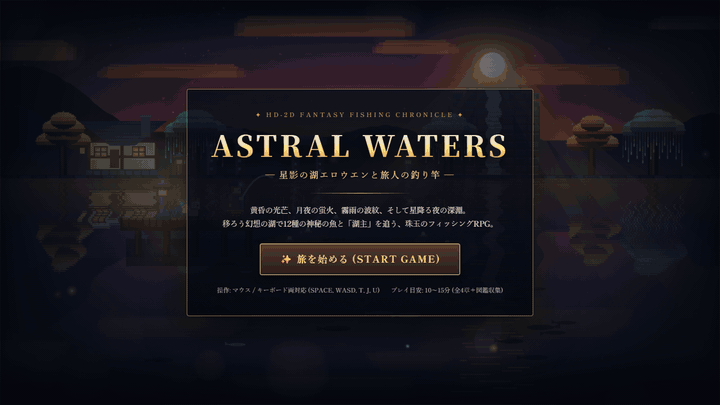

# ✦ ASTRAL WATERS: 星影の湖エロウエンと旅人の釣り竿 ✦

> **『オクトパストラベラー』のHD-2D表現に着想を得た、幻想的な湖を舞台とする短編フィッシングRPG**



🎬 **[高画質MP4プレイ動画（1280×720 / 13.3秒）はこちら (`docs/demo.mp4`)](docs/demo.mp4)**

---

## 1. ゲーム紹介

**『ASTRAL WATERS — 星影の湖エロウエンと旅人の釣り竿 —』** は、温かみのある2Dドット絵（ピクセルアート）と、奥行きのある3Dパースペクティブ空間・動的ライティング・水面反射・チルトシフト被写界深度（DoF）を融合させた **HD-2D風ファンタジー釣りゲーム** です。

プレイヤーは星詠みの旅人 **「ルミナ」** となり、相棒の霊狐 **「ポコ」** とともに神秘の湖「エロウエン湖」を訪れます。黄昏・宵闇・霧雨・星降りへと移ろう景色の中で全12種の幻想魚を収集し、老匠 **「オルバス翁」** の工房で釣具を鍛え上げ、星降る夜の深淵に君臨する伝説の湖主 **『星喰らいのレヴィアタン』** の制覇を目指します（1プレイ **10〜15分程度** で全4章の物語クリア＆エンディング到達が可能、クリア後は図鑑コンプリートを目指すフリープレイに移行します）。

---

## 2. ゲームの特徴

### 🎨 奥行きと空気感を描く HD-2D ビジュアル表現
- **リアルタイム平面水面反射＆波面歪み**：空のグラデーション、太陽・月、オーロラ、山並み、水没遺跡、揺れる柳や紅葉樹、工房の窓明かり、石灯籠の灯火がすべてリアルタイムに湖面へ上下反転投影され、水深に応じたサイン波で揺らぎます。
- **ボリューメトリック・ゴッドレイ（光芒）と動的ポイントライト**：木々の間から差し込む夕陽・月光の光芒や、石灯籠・工房の窓・ルミナの腰ランタン・ポコの尾火が周囲と水面を照らします。
- **チルトシフト被写界深度（DoF）＆環境パーティクル**：画面上下端のアウトフォーカス処理と前景ボケ玉（Bokeh）、風に揺れる柳の枝葉、夜空を舞う蛍火・星屑、雨粒と水面の同心円波紋により、箱庭（ジオラマ）のような立体感を演出します。

### ⚔️ 『オクトパストラベラー』着想の「シールドブレイク＆星凪ブースト」釣りバトル
- **魚ごとの行動アーキタイプ（全6系統）**：
  - `疾走型`（素早い左右移動）、`潜航型`（強い引き込み）、`跳躍型`（水面への華麗なジャンプ）、`幻惑型`（共鳴変化）、`剛力型`（高負荷の突進）、`湖主・覇王型`（多段シールド＆大跳躍を持つボス戦）。
- **カウンター＆シールドブレイク（🛡️ BREAK!!）**：
  - 魚が引く方向（`◀ 左` / `▲ 跳躍・潜航` / `▶ 右`）に合わせてロッドを操作するとカウンターが成立し、魚の **シールドポイント（🛡️）** を削ります。
  - シールドを `0` にするとガラスが砕け散る演出とともに **💥 SHIELD BREAK!!** が発生！魚が一定時間気絶し、糸の負荷を抑えながら **2.4倍の大ダメージ** で一気に巻き上げられます。
- **星凪ブースト（BP ◆◆◆）**：
  - ファイト中に溜まる **BP（ブーストポイント）** を消費して発動。糸のテンション（張力）を瞬時に冷却し、シールドを一気に削りながら超高速巻き上げを行います。

### 🌦️ 移ろう4つの時間・天候と5つの釣り場スポット
- **4つの時間・天候**（釣果に応じて自然推移するほか、桟橋の「星見の鐘 `[T]`」でいつでも切り替え可能）：
  1. 🌇 **黄昏 (夕凪)**：琥珀色の光芒が差し込む夕マヅメ。琥珀ブナや紅蓮ヒメマスが活性化。
  2. 🌙 **宵闇 (月夜)**：無数の蛍火が舞う静謐な月夜。月影コイや蒼夜光エイが出現。
  3. 🌧️ **霧雨 (翠雨)**：翡翠色の霧と雨紋が広がる天候。霧雨リュウグウや翡翠龍ナマズが浮上。
  4. 🌠 **星降り (天河)**：夜空にオーロラが架かり星屑が降り注ぐ神秘の夜。天河ギンザケや **【湖主】星喰らいのレヴィアタン** が出現。
- **5つの釣り場スポット**（`[1]〜[5]` キーで切替）：
  - `1: 浅瀬の葦原` / `2: 桟橋の灯影` / `3: 翠滝の淵` / `4: 水没遺跡の回廊` / `5: 星詠みの深淵`

### 📖 魚類博物誌（図鑑）と星影の釣具工房（アップグレード）
- **エロウエン湖 魚類博物誌（全12種）**：釣果数・最大体長（`cm`）・金冠サイズ（`👑 GOLD CROWN`）・生息域・生態ロアを記録。未発見の魚には出現条件のヒントが表示されます。
- **星影の釣具工房（3系統×4段階＝全12種の装備）**：釣果や章クリアで得た「星鱗貨（G）」と「星結晶（✦）」を使い、**釣り竿（ROD）・リール（REEL）・ルアー（LURE）** を鍛造強化できます。

---

## 3. 操作方法

マウス操作のみでも、キーボードショートカット併用でも快適にプレイできます。

| フェーズ | 操作 | キーボード | マウス / UI操作 |
| :--- | :--- | :--- | :--- |
| **待機・探索** | 釣り場スポット切替 | `1` 〜 `5` または `A` / `D` (`←` / `→`) | 画面下のスポットタブをクリック |
| **待機・探索** | キャスト（投擲）ゲージ溜め・投擲 | `Space` 長押し → 離す | 画面クリック長押し → 離す |
| **浮き待機中** | 浮きを揺らして波紋で誘う | `A` / `D` / `Space` | 画面クリック |
| **浮き待機中** | 仕掛けを回収して戻る | `Esc` または `R` | — |
| **ヒット時** | フッキング（合わせ） | `Space`（自動フッキング補助あり） | クリック（自動フッキング補助あり） |
| **釣りバトル** | リールを巻く | `Space` 長押し | `リールを巻く` ボタン or 画面左クリック長押し |
| **釣りバトル** | カウンター（シールド削り） | `A`(`←`):左 / `W`(`↑`):跳躍 / `D`(`→`):右 | `◀ 左いなす` / `▲ 跳躍合わせ` / `▶ 右いなす` ボタン |
| **釣りバトル** | 星凪ブースト発動 | `E` または `Shift` | `✨ 星凪ブースト発動` ボタン |
| **全体メニュー** | 時間・天候の切り替え（星見の鐘） | `T` | 左上の天候バッジをクリック |
| **全体メニュー** | 魚類博物誌（図鑑）を開く | `J` | 右上の `📖 図鑑` ボタン |
| **全体メニュー** | 星影の釣具工房を開く | `U` | 右上の `⚒️ 工房` ボタン |
| **全体メニュー** | サウンド ON / OFF | `M` | 右上の `🔊` ボタン |
| **全体メニュー** | 操作ガイドを開く | `H` | 右上の `?` ボタン |

---

## 4. 起動・プレイ方法

外部ライブラリやビルド工程に依存しない設計のため、以下のいずれの方法でもすぐにプレイ可能です。

### 方法A：ローカルHTTPサーバーで起動（推奨）
```bash
# Node.js がある場合
npm start
# または
npx serve -l 8080 .

# Python がある場合
python -m http.server 8080
```
ブラウザで `http://localhost:8080` を開いてプレイしてください。

### 方法B：`index.html` を直接ブラウザで開く
外部アセットのCORS制限を受けないプロシージャル・ピクセルアート生成＆インラインシェーダ構成のため、`index.html` をダブルクリックして直接Chrome / Edge / Firefox / Safariで開いても動作します。

---

## 5. 使用技術

- **言語：** HTML5, CSS3, JavaScript (ES6+)
- **グラフィックス・演出（`js/renderer.js`, `js/sprites.js`）：**
  - カスタム HD-2D ハイブリッド描画パイプライン（HTML5 Canvas 2D 多層オフスクリーンバッファ合成）
  - ニアレストネイバー（`imageSmoothingEnabled = false`）による純粋なドット絵スプライト生成（ディザリング・リムハイライト・発光マスク付き）
  - リアルタイム平面水面反射（Planar Reflection）＋深度別サイン波スキャンライン変位
  - スクリーン合成によるボリューメトリック・ゴッドレイ（光芒）、動的ポイントライト、低解像度縮小バッファを用いたソフトブルーム（光彩）、チルトシフト被写界深度（DoF）
- **サウンド（`js/audio.js`）：**
  - Web Audio API によるリアルタイム・ポリフォニックBGMシーケンサー（探索時のハープ＆フルート室内楽、バトル時のヒロイックな変拍子風ストリングス、湖主戦のボス楽曲）および物理ノイズバッファを用いた環境音・効果音合成
- **データ永続化：**
  - `localStorage` による自動セーブ＆コンティニュー機能

---

## 6. AI制作情報

- **AIサービス名：** Gemini (Google Antigravity)
- **使用モデル名：** Gemini 4 Argon (Medium)
- **ゲームエンジン・フレームワーク：** 独自HD-2Dハイブリッド描画エンジン（Vanilla JavaScript + HTML5 Canvas 2D Multi-Pass Pipeline + Web Audio API）
- **使用言語：** HTML5, CSS3, JavaScript

---

## 7. 制作に使用したプロンプト全文

以下は、本作の制作に使用した依頼プロンプトの全文（省略・要約・改変なし）です。追加の制作指示はありません。

```text
オクトパストラベラーのHD-2D表現に着想を得た、美しく幻想的な釣りゲームを制作してください。

ブラウザで快適にプレイでき、10〜15分程度で一区切りつく、商業インディーゲームのような完成度を目指してください。

**最も重視するのは、奥行きのある美しいピクセルアート、統一されたアートスタイル、気持ちのよい演出、洗練されたUI/UXです。**

### ゲーム内容
- 幻想的な湖を舞台にした釣りゲーム
- 魚ごとに特徴のある釣りのミニゲーム
- 魚の収集、図鑑、装備のアップグレード
- 昼夜や天候による景色と釣れる魚の変化
- 短時間でも達成感のあるゲーム進行

### ビジュアル
- 2Dドット絵と立体的な空間表現を組み合わせたHD-2D風
- 奥行きのある背景、立体的な地形、自然なカメラワーク
- 美しいライティング、影、水面の反射、霧、被写界深度
- 木々の揺れ、水の波紋、蛍などの環境アニメーション
- ゲームの世界観と調和した統一感のあるUI
- 単純な図形や仮素材を並べただけのプロトタイプにはしない

### 制作方針
- 技術選定、ゲームエンジン、プログラミング言語、アセットの制作・調達方法は自由
- コンテンツ量よりも、ビジュアル・演出・操作感の完成度を優先する
- オリジナルの世界観とキャラクターデザインにする
- 必要に応じて、利用条件を遵守した公開アセットを使用してよい

### GitHub README
README.mdには以下を含めてください。

1. ゲームタイトルと簡単な紹介
2. **実際のゲームプレイを録画したGIFアニメーション**
   - READMEの冒頭付近に埋め込み、GitHub上で自動再生されるようにする
   - 10〜15秒程度
   - 釣り、魚のヒット、演出、景色など、ゲームの魅力が伝わる場面を収録
   - 可能なら長めのMP4プレイ動画も保存し、READMEからリンクする
   - GIFは `docs/demo.gif` に配置
3. ゲームの特徴と操作方法
4. 起動・プレイ方法
5. 使用技術
6. **制作に使用した、この依頼プロンプトの全文**
   - 省略・要約・改変せず、READMEにそのまま掲載する
   - 追加の制作指示があった場合はそれも記録する
7. 動作確認結果と既知の問題

GIFや動画は、実際に動作するゲームをキャプチャしたものを使用してください。静止画像を加工した架空のプレイ映像で代用しないでください。

### AI制作情報
READMEには、比較実験の記録として以下を記載してください。

- **AIサービス名：** ChatGPT / Claude / Gemini など
- **使用モデル名：** GPT-6 Astra / Claude 5.5 Opus / Gemini 4 Argon など、実際に使用したモデルの正式名称
- **ゲームエンジン・フレームワーク**
- **使用言語**
- **制作に使用したプロンプト全文**

モデル名やバージョンを実行環境から確認できない場合は、推測せず「未確認」と記載してください。

### 自律制作
私への途中確認や質問は不要です。

企画、設計、実装、素材制作、動作確認、バグ修正、ビジュアル改善、プレイ動画の録画、README作成まで、利用可能なツールの範囲で自律的に実施してください。

実際にブラウザでゲームを起動し、プレイ画面を確認して改善してください。

最終的に、ブラウザでプレイ可能なゲーム一式とREADMEを完成させてください。

実行環境の制約などで実施できなかった工程は、実施したかのように装わずREADMEに明記してください。
```

---

## 8. 動作確認結果と既知の問題

### ✅ 動作確認結果
- **テスト環境：** Windows 11 / Google Chrome (Headless & Desktop Viewport `1280×720`) + ローカルHTTPサーバー
- **検証項目：**
  - タイトル画面表示、新規開始・セーブデータからのコンティニュー動作：正常（コンソールエラー・例外 `0件`）
  - 5つの釣り場スポット切替、4つの天候・時間帯（黄昏・宵闇・霧雨・星降り）のリアルタイム遷移と水面反射・パーティクル変化：正常
  - キャストゲージ（`PERFECT CAST!` 判定）、浮きの着水・波紋誘い、魚のヒット、カウンターによるシールドブレイク（`💥 SHIELD BREAK!!`）、星凪ブースト（`BP`消費）、巻き上げによる捕獲判定：正常
  - 釣果ショーケースモーダル、魚類博物誌（全12種表示・詳細切替）、星影の釣具工房（全3系統×4段階の鍛造・装備切替）、全4章の進行とエンディング到達：正常
  - 実際のブラウザ動作からのプレイ動画キャプチャ（`docs/demo.gif` および `docs/demo.mp4`）：正常生成・再生確認済み

### ℹ️ 既知の問題・注意事項
- ブラウザの自動再生ポリシー（Autoplay Policy）により、BGMおよび効果音（Web Audio API）はタイトル画面の「旅を始める」ボタン押下など、ユーザーの初回クリック／キー入力後に再生が開始されます。
- オフライン環境ではGoogle Fonts（`Shippori Mincho`, `Cinzel`）が読み込まれない場合がありますが、ローカルの明朝体・セリフ体フォント（`Yu Mincho`, `Hiragino Mincho ProN`, `serif`）へ自動的にフォールバックし、レイアウト崩れなくプレイ可能です。
